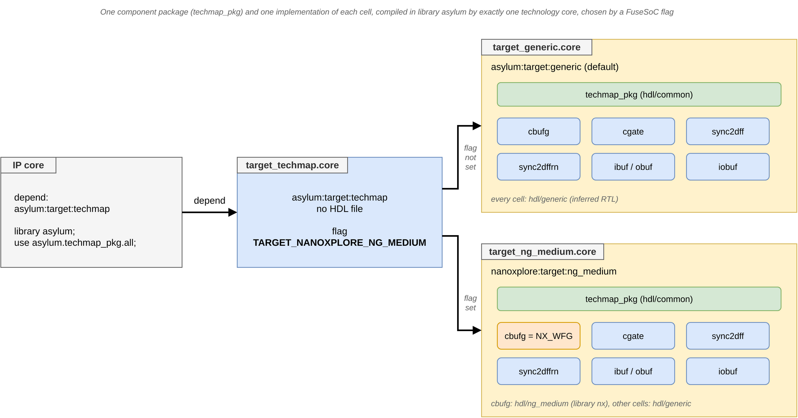
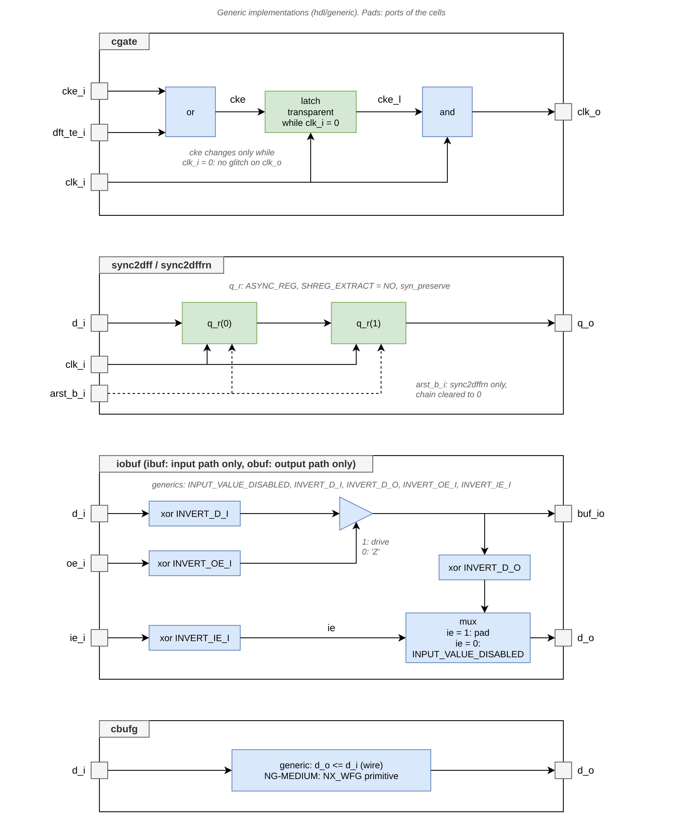
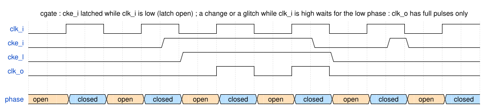

<!--
  README MODEL (common to every Asylum IP, keep the same headings)
  ----------------------------------------------------------------
  Regenerate from the sources, never from the previous README text alone:
    hdl/*.vhd (entities, generics, ports), hdl/csr/*.hjson (register map),
    <IP>.core (VLNV, targets, depends), mk/targets.txt, sim/, syn/, esw/.
  Sections, in this order:
    badges / title + one-line pitch / Overview / Features / Block Diagram /
    Getting Started / Hardware Interfaces / Configuration / Resources /
    Theory of Operation / Registers / Programmer's Guide /
    Design Verification / Dependencies and Related IPs / License
  Rules:
    - English, short and factual: every statement backed by the sources.
    - No VLNV line: the version badge shows it.
    - Badges: first line version, license; second line CI, lint, sim, syn.
    - Block diagram and FSM: pages Overview and FSM of doc/<NAME>.drawio, exported to
      doc/<NAME>-Overview.png and doc/<NAME>-FSM.png (make -C doc).
    - Timing diagrams: WaveDrom source doc/<NAME>-<what>.json, rendered
      doc/<NAME>-<what>.svg (make -C doc), shown as images.
    - No CPU named (OpenBlaze, PicoBlaze, RISC-V) outside the CPU and SoC IPs.
    - Registers: link to the generated hdl/csr/<X>_csr.md, never copy the tables.
    - Tables: Configuration = Name|Type|Default|Description,
      Hardware Interfaces = Name|Direction|Type|Description, grouped by interface.
    - A section with nothing to say is one line ("This IP has no
      software-visible registers."), never removed.
  Cell library (this repository): Hardware Interfaces = one table of the
  cells, then the ports of each cell; Resources = syn_* figures of the
  generic cells only (the NG-MEDIUM cells are vendor primitives).
-->
[](https://github.com/deuskane/asylum-target-techmap/tags)
[](LICENSE)

[](https://github.com/deuskane/asylum-target-techmap/actions/workflows/ci.yml)
[](https://github.com/deuskane/asylum-target-techmap/actions/workflows/ci.yml)
[](https://github.com/deuskane/asylum-target-techmap/actions/workflows/ci.yml)
[](https://github.com/deuskane/asylum-target-techmap/actions/workflows/ci.yml)

# Technology cells (techmap)

**The few technology-dependent cells of Asylum (clock buffer, clock gate, synchronizers, I/O buffers) behind one VHDL package, with a generic implementation and a NanoXplore NG-MEDIUM variant chosen by a FuseSoC flag.**

Part of the [Asylum project](https://github.com/deuskane/asylum-project), a collection of small IP cores, written to be read and learned from.

## Table of Contents

1. [Overview](#overview)
2. [Features](#features)
3. [Block Diagram](#block-diagram)
4. [Getting Started](#getting-started)
5. [Hardware Interfaces](#hardware-interfaces)
6. [Configuration](#configuration)
7. [Resources](#resources)
8. [Theory of Operation](#theory-of-operation)
9. [Registers](#registers)
10. [Programmer's Guide](#programmers-guide)
11. [Design Verification](#design-verification)
12. [Dependencies and Related IPs](#dependencies-and-related-ips)
13. [License](#license)

## Overview

A few functions cannot be written once for every target: a global clock buffer, a clock gate, the flip-flops of a synchronizer, an I/O pad. This repository isolates them so that the other IPs stay technology independent:

- the IPs instantiate the components of one package, `asylum.techmap_pkg`, and depend on one FuseSoC core, `asylum:target:techmap`;
- that core contains no HDL file: it pulls in exactly one technology core, which compiles the package and an implementation of every cell into library `asylum`;
- the technology is chosen when the flow runs, with a FuseSoC flag: no source of the IPs changes.

Three cores live in the repository:

| Core file | VLNV | Content |
|-----------|------|---------|
| [target_techmap.core](target_techmap.core) | `asylum:target:techmap` | Selection only: one of the two cores below |
| [target_generic.core](target_generic.core) | `asylum:target:generic` | Generic (inferred) cells, the default; holds the lint, simulation and synthesis targets |
| [target_ng_medium.core](target_ng_medium.core) | `nanoxplore:target:ng_medium` | NanoXplore NG-MEDIUM cells (flag `TARGET_NANOXPLORE_NG_MEDIUM`) |

## Features

- One component package, [techmap_pkg](hdl/common/techmap_pkg.vhd), shared by every technology
- Clock cells: `cbufg` (global clock buffer), `cgate` (latch-based glitch-free clock gate with a DFT test enable)
- Clock domain crossing: `sync2dff`, `sync2dffrn` (2 flip-flop synchronizers, without / with asynchronous reset), with the synthesis attributes that keep the two flip-flops together
- I/O cells: `ibuf`, `obuf`, `iobuf`, with generics to invert the data and the enables and to choose the value read when the input is disabled
- Technology chosen by the FuseSoC flag `TARGET_NANOXPLORE_NG_MEDIUM`
- NG-MEDIUM: `cbufg` mapped on the `NX_WFG` primitive, the other cells shared with the generic core

## Block Diagram

Selection of the technology core:



Generic implementation of the cells:



## Getting Started

The cores of the Asylum IPs are published in the FuseSoC library [asylum-cores](https://github.com/deuskane/asylum-cores) (with the UVVM core used by the testbench):

```bash
pip install fusesoc
fusesoc library add https://github.com/deuskane/asylum-cores
fusesoc run --target sim_techmap_cgate asylum:target:generic   # needs GHDL
```

To use a cell in your design, add `asylum:target:techmap` to the `depend` list of your core and instantiate the component (library `asylum`):

```vhdl
library asylum;
use     asylum.techmap_pkg.all;

  -- Resynchronize an external signal in the clk domain
  ins_sync : sync2dffrn
    port map
    (clk_i    => clk
    ,arst_b_i => arst_b
    ,d_i      => button_async
    ,q_o      => button_sync
    );

  -- Bidirectional pad, output enable active low
  ins_pad_sda : iobuf
    generic map
    (INPUT_VALUE_DISABLED => '1'
    ,INVERT_D_I           => '0'
    ,INVERT_D_O           => '0'
    ,INVERT_OE_I          => '1'
    ,INVERT_IE_I          => '0'
    )
    port map
    (buf_io               => sda_io
    ,d_i                  => sda_out
    ,d_o                  => sda_in
    ,oe_i                 => sda_oe_b
    ,ie_i                 => '1'
    );
```

Without flag, the generic cells are used. To map the cells on NG-MEDIUM, set the flag for the whole run, in the target of the top-level core:

```yaml
  impl_ng_medium:
    flags:
      TARGET_NANOXPLORE_NG_MEDIUM: true
```

or on the command line: `fusesoc run --flag TARGET_NANOXPLORE_NG_MEDIUM ...`. The NG-MEDIUM `cbufg` needs library `nx` (`nxPackage`), which comes with the NanoXplore tools and is not a FuseSoC dependency.

## Hardware Interfaces

Units compiled in library `asylum` by both technology cores:

| Cell | Purpose | Ports | Generic implementation | NG-MEDIUM implementation |
|------|---------|-------|------------------------|--------------------------|
| `techmap_pkg` | Components of every cell | | [hdl/common/techmap_pkg.vhd](hdl/common/techmap_pkg.vhd) | same file |
| `cbufg` | Global clock buffer | `d_i`, `d_o` | Wire `d_o <= d_i`, the synthesis tool infers the buffer ([hdl/generic/cbufg.vhd](hdl/generic/cbufg.vhd)) | `NX_WFG` primitive ([hdl/ng_medium/cbufg.vhd](hdl/ng_medium/cbufg.vhd)) |
| `cgate` | Clock gate | `clk_i`, `cke_i`, `dft_te_i`, `clk_o` | Latch + AND ([hdl/generic/cgate.vhd](hdl/generic/cgate.vhd)) | generic file |
| `sync2dff` | 2 flip-flop synchronizer | `clk_i`, `d_i`, `q_o` | 2-bit shift register ([hdl/generic/sync2dff.vhd](hdl/generic/sync2dff.vhd)) | generic file |
| `sync2dffrn` | 2 flip-flop synchronizer, asynchronous reset | `clk_i`, `arst_b_i`, `d_i`, `q_o` | 2-bit shift register cleared by `arst_b_i` ([hdl/generic/sync2dffrn.vhd](hdl/generic/sync2dffrn.vhd)) | generic file |
| `ibuf` | Input buffer | `buf_io`, `d_o`, `ie_i` | `d_o` from the pad, `'Z'` driven on the pad ([hdl/generic/ibuf.vhd](hdl/generic/ibuf.vhd)) | generic file |
| `obuf` | Tri-state output buffer | `buf_io`, `d_i`, `oe_i` | `d_i` or `'Z'` on the pad ([hdl/generic/obuf.vhd](hdl/generic/obuf.vhd)) | generic file |
| `iobuf` | Bidirectional buffer | `buf_io`, `d_i`, `d_o`, `oe_i`, `ie_i` | `obuf` and `ibuf` on one pad ([hdl/generic/iobuf.vhd](hdl/generic/iobuf.vhd)) | generic file |

### cbufg

| Name | Direction | Type | Description |
|------|-----------|------|-------------|
| `d_i` | in | std_logic | Input clock |
| `d_o` | out | std_logic | Buffered clock |

### cgate

| Name | Direction | Type | Description |
|------|-----------|------|-------------|
| `clk_i` | in | std_logic | Input clock |
| `cke_i` | in | std_logic | Clock enable, active high (0: clock stopped low, 1: clock running) |
| `clk_o` | out | std_logic | Gated clock |
| `dft_te_i` | in | std_logic | DFT test enable, active high (forces the clock on) |

### sync2dff / sync2dffrn

| Name | Direction | Type | Description |
|------|-----------|------|-------------|
| `clk_i` | in | std_logic | Destination clock |
| `arst_b_i` | in | std_logic | `sync2dffrn` only: asynchronous reset, active low (chain cleared to 0) |
| `d_i` | in | std_logic | Asynchronous input |
| `q_o` | out | std_logic | Synchronized output (2 rising edges of latency) |

### ibuf / obuf / iobuf

| Name | Direction | Type | Description |
|------|-----------|------|-------------|
| `buf_io` | inout | std_logic | Pad (driven by `obuf` / `iobuf`; `ibuf` only reads it and drives `'Z'`) |
| `d_i` | in | std_logic | `obuf`, `iobuf`: data to drive on the pad |
| `oe_i` | in | std_logic | `obuf`, `iobuf`: output enable (`buf_io` = `'Z'` when disabled) |
| `d_o` | out | std_logic | `ibuf`, `iobuf`: data read from the pad |
| `ie_i` | in | std_logic | `ibuf`, `iobuf`: input enable (`d_o` = `INPUT_VALUE_DISABLED` when disabled) |

## Configuration

Only the I/O buffers have generics (`cbufg`, `cgate`, `sync2dff` and `sync2dffrn` have none):

| Name | Type | Default | Description |
|------|------|---------|-------------|
| `INPUT_VALUE_DISABLED` | std_logic | `'0'` | `ibuf`, `iobuf`: value of `d_o` when the input is disabled |
| `INVERT_D_I` | std_logic | `'0'` | `obuf`, `iobuf`: `'1'` inverts `d_i` before the pad |
| `INVERT_D_O` | std_logic | `'0'` | `ibuf`, `iobuf`: `'1'` inverts the pad before `d_o` (not `INPUT_VALUE_DISABLED`) |
| `INVERT_OE_I` | std_logic | `'0'` | `obuf`, `iobuf`: `'1'` makes `oe_i` active low |
| `INVERT_IE_I` | std_logic | `'0'` | `ibuf`, `iobuf`: `'1'` makes `ie_i` active low |

The technology is a FuseSoC flag of the run, not a generic:

| Flag | Default | Description |
|------|---------|-------------|
| `TARGET_NANOXPLORE_NG_MEDIUM` | not set | Set: `nanoxplore:target:ng_medium`; not set: `asylum:target:generic` |

## Resources

Figures of the `syn_*` target (`make nonreg_syn`, see [Targets](#targets)): [syn/techmap_wrapper.vhd](syn/techmap_wrapper.vhd) with the generics of the configuration, synthesized by Yosys and its GHDL plugin; the reports are in the build directory of the target. Generic cells only: the NG-MEDIUM `cbufg` is a vendor primitive that Yosys cannot map.

| Configuration | LUT¹ | LUTRAM¹ | FF¹ | CARRY4¹ | MUXF7/F8¹ | BRAM¹ | DSP¹ | Area² (µm²) | kGE³ |
|---|---|---|---|---|---|---|---|---|---|
| `syn_sync` (`cbufg`, `sync2dff`, `sync2dffrn`) | 2 | 0 | 4 | 0 | 0 | 0 | 0 | 90.09 | 0.024 |

`cbufg` is a wire (no cell); `sync2dff` and `sync2dffrn` are 2 flip-flops each. Not in the table:

- `cgate`: its latch is rejected by the GHDL plugin of Yosys (the `ghdl --synth` check `lint_ghdl_synth_cgate_latch` allows it with `--latches`); its cost is a latch, an OR and an AND gate;
- `ibuf`, `obuf`, `iobuf`: their tri-states are pads, rejected by the Artix-7 flow without I/O pads (`synth_xilinx -noiopad`); they map on the I/O cells of the chip, at its top level.

¹ Xilinx Artix-7 (LUT6), Yosys 0.33 `synth_xilinx -flatten -noiopad -noclkbuf`, before place and route: every cell of the netlist is counted, Vivado may differ. An `INV` counts as a `LUT1`: `synth_xilinx` puts one on the reset pin of each flip-flop with the active-low reset (the 2 flip-flops of `sync2dffrn`). No memory.

² SkyWater sky130 `sky130_fd_sc_hd`, typical corner (tt, 25 °C, 1.80 V), Yosys 0.33 `synth` + `dfflibmap` + `abc -liberty`: standard-cell area only (4 flip-flops), no timing constraint, no buffering, clock tree or placement.

³ Area in thousands of NAND2 gate equivalents (`sky130_fd_sc_hd__nand2_1` = 3.7536 µm²).

## Theory of Operation

### Selection of the technology

[target_techmap.core](target_techmap.core) has two filesets without file, each with one dependency, and its `default` target chooses one of them with a flag condition:

```yaml
    filesets        :
      -  "TARGET_NANOXPLORE_NG_MEDIUM ? (target_nanoxplore_ng_medium)"
      - "!TARGET_NANOXPLORE_NG_MEDIUM ? (target_generic)"
```

FuseSoC flags apply to the whole dependency tree of a run, so every IP of a design gets the same technology. Both technology cores compile [hdl/common/techmap_pkg.vhd](hdl/common/techmap_pkg.vhd) and one entity per component of the package, with the same name and ports, in library `asylum`; the consuming IPs only see the components. The two cores only differ by `cbufg`: [hdl/generic/cbufg.vhd](hdl/generic/cbufg.vhd) in `target_generic.core`, [hdl/ng_medium/cbufg.vhd](hdl/ng_medium/cbufg.vhd) in `target_ng_medium.core`; the other cells come from `hdl/generic/` in both.

To add a technology: create `hdl/<tech>/` with the cells that differ, a `target_<tech>.core` listing `hdl/common/techmap_pkg.vhd` with the specific and the generic files, and a flag-conditioned fileset in `target_techmap.core`. Every implementation must keep the interface declared in `techmap_pkg`.

### cbufg

Generic: `d_o <= d_i`, the synthesis tool inserts the clock buffer itself. NG-MEDIUM: an `NX_WFG` (waveform generator of the clock network, `nx.nxPackage`) with `wfg_edge => '0'` (not inverted), `mode => '0'` (no pattern), `delay_on => '0'`, `RDY => '1'`. Two alternatives, `NX_BD` (`global_lowskew`) and `NX_CSC`, are present in comments.

### cgate

`cke = cke_i or dft_te_i` goes through a latch transparent while `clk_i = '0'`, and `clk_o = clk_i and cke_l`. The enable seen by the AND gate can only change while the clock is low, so `clk_o` only has full pulses: a change of `cke_i` (or a glitch) while `clk_i` is high waits for the next low phase.



The latch is on purpose: `lint_ghdl_synth_cgate_latch` allows it (`ghdl --synth --latches`), the other synthesis checks leave `cgate` out.

### sync2dff / sync2dffrn

2-bit shift register `q_r` clocked on the rising edge of `clk_i`, `q_o = q_r(1)`: a change of `d_i` appears on `q_o` after 2 rising edges. `sync2dffrn` clears the chain asynchronously when `arst_b_i = '0'`; `sync2dff` has no reset.

`q_r` carries synthesis attributes so that the two flip-flops stay flip-flops (no shift register extraction, no retiming, duplication or merging) and are placed close together: `ASYNC_REG = "TRUE"` (Xilinx Vivado / ISE), `SHREG_EXTRACT = "NO"` (Xilinx Vivado / XST), `syn_preserve = true` (Synplify and NanoXplore NXmap). Both technology cores use these files, so the attributes also apply on NG-MEDIUM. `d_i` is asynchronous: the consuming design declares the path to `q_r(0)` as a false path (or constrains it with a maximum delay).

### ibuf / obuf / iobuf

| Cell | Pad | Input path |
|------|-----|------------|
| `ibuf` | `'Z'` (never driven) | `d_o` = pad (inverted if `INVERT_D_O`) when `ie` = 1, else `INPUT_VALUE_DISABLED` |
| `obuf` | `d_i` (inverted if `INVERT_D_I`) when `oe` = 1, else `'Z'` | none |
| `iobuf` | as `obuf` | as `ibuf`: `d_o` reads the pad, also while the cell drives it |

`oe` / `ie` are `oe_i` / `ie_i`, inverted when `INVERT_OE_I` / `INVERT_IE_I` = `'1'`. The `'Z'` assignments make tri-state buffers: the cells must end up at the top level of the chip or FPGA to map on its I/O cells.

## Registers

This IP has no software-visible registers.

## Programmer's Guide

This IP has no software interface: its cells are instantiated by the hardware of the other IPs.

## Design Verification

### Testbenches

| File | DUT | Description |
|------|-----|-------------|
| [sim/techmap/tb_techmap.vhd](sim/techmap/tb_techmap.vhd) | every generic cell (components of `techmap_pkg`) | Self-checking UVVM testbench, generic `TESTS_LIST` (scenarios, see below). One instance of `cbufg` on a data input and one on the clock, `cgate`, `sync2dff`, `sync2dffrn`, and the I/O buffers once per combination of their generics (8 `ibuf`, 4 `obuf`, 32 `iobuf`), the pads resolved with a testbench driver. A monitor checks that every `clk_o` pulse of `cgate` starts on a rising edge of `clk_i` and lasts a full half period (checks without `=> OK` line) and counts the pulses. Scenarios in `tb_techmap_<name>_pkg` (one per cell), names and dispatch in [tb_techmap_tests_pkg](sim/techmap/tb_techmap_tests_pkg.vhd), cell signals (records) and helpers in [tb_techmap_bfm_pkg](sim/techmap/tb_techmap_bfm_pkg.vhd) |
| [sim/src/tb_dummy.vhd](sim/src/tb_dummy.vhd) | every cell | Elaboration check only (`lint_generic`): one instance of each cell, inputs tied to `'0'`, no check |

### Scenarios (`TESTS_LIST`)

The scenarios are chosen at run time with the generic `TESTS_LIST`: names separated by `,` without space (`cgate,iobuf,cgate`), a name may be repeated. The sequencer first checks every name (an unknown name is a `TB_ERROR` before any scenario runs), then for each scenario sets the inputs idle, drives a reset pulse (`arst_b_i` of `sync2dffrn`), logs `TEST <i>/<N> : <name>` and runs it. The empty list (default) only compiles and elaborates the testbench. The list is parsed with `list_length` / `list_item` / `list_contains` of `asylum.string_pkg` (`asylum:utils:pkg` >= 1.10.0).

Checks counted as the `=> OK` lines of the log:

| Name | Checks | Description |
|------|--------|-------------|
| `cbufg` | 5 | `d_o = d_i` for `'0'` and `'1'`; clock high and low, edge not delayed |
| `cgate` | 16 | Clock gated, then running; `cke_i` falling, rising or glitching while `clk_i` is high acts only after the next low phase (no cut or partial pulse); `cke_i` changing while `clk_i` is low acts on the next pulse; `dft_te_i` forces the clock (alone and with `cke_i`), also latched |
| `sync2dff` | 9 | Chain flushed with 0; latency of 2 rising edges in both directions, `q_o` unchanged after the falling edge; a 1-cycle pulse lasts 1 cycle |
| `sync2dffrn` | 11 | `q_o` held at 0 during the reset with `d_i = 1`; latency of 2 rising edges, unchanged after the falling edge; an asynchronous reset between two edges clears `q_o` at once and the whole chain |
| `ibuf` | 48 | `d_o` of the 8 generic combinations for every `ie_i` and pad value; pad never driven, for both `ie_i` |
| `obuf` | 16 | Pad of the 4 generic combinations for every `oe_i` and `d_i` (`'Z'` exactly when disabled) |
| `iobuf` | 1064 | Pad and `d_o` of the 32 generic combinations for every `oe_i`, `ie_i`, `d_i` and external pad value (loopback when the output is enabled); `'Z'` on the pad when disabled; `d_o` reads the pad (`'X'`) when the testbench fights the cell |

The testbench was validated with 52 RTL mutants of the generic cells (inverted or ignored generics, `'Z'` replaced by a weak or strong level, latch removed or moved to the high phase, synchronizer of 1 or 3 stages or clocked on both edges, synchronous or partial reset, ...): each one is killed by the scenario of its cell.

### Targets

`mk/targets.txt` lists the targets of `target_generic.core` (`FILE_CORE ?= target_generic.core` in `mk/defs.mk`); `target_techmap.core` and `target_ng_medium.core` only have a `default` target.

| Target | Toplevel | Description |
|--------|----------|-------------|
| `default` | | HDL fileset only (not a simulation) |
| `sim_techmap` | `tb_techmap` | Build and elaboration only (`TESTS_LIST` empty), base of the scenario targets and of the list runs (`--TESTS_LIST=<a>,<b>`) |
| `sim_techmap_<name>` | `tb_techmap` | One target per scenario: `sim_techmap_cbufg`, `_cgate`, `_sync2dff`, `_sync2dffrn`, `_ibuf`, `_obuf`, `_iobuf` (1169 checks in all) |
| `lint_generic` | `tb_dummy` | Analysis, elaboration and run of [sim/src/tb_dummy.vhd](sim/src/tb_dummy.vhd) |
| `lint_ghdl` | `asylum.techmap_wrapper` | GHDL `-Wall` analysis and elaboration of [syn/techmap_wrapper.vhd](syn/techmap_wrapper.vhd) (every cell, every port on a top-level port) |
| `lint_ghdl_synth_<config>` | `asylum.techmap_wrapper` | `ghdl --synth` check for 4 configurations: `no_cgate` (every cell but `cgate`), `no_cgate_inverted` (same, I/O buffer generics at 1), `cgate_latch` (every cell, latches allowed), `sync` (`cbufg` and the synchronizers) |
| `syn_sync` | `asylum.techmap_wrapper` | Synthesis with Yosys, Artix-7 and sky130 (see [Resources](#resources)), configuration `sync` (`WITH_CGATE = false`, `WITH_IO_BUFFERS = false`) |

The wrapper generics `WITH_CGATE` and `WITH_IO_BUFFERS` remove `cgate` (latch) and the I/O buffers (tri-states); the other generics are the I/O buffer generics, as naturals (0 / 1) because a FuseSoC parameter value cannot contain a quote.

Every `sim_*`, `lint_*` and `syn_*` target is a job of the [GitHub CI](https://github.com/deuskane/asylum-target-techmap/actions/workflows/ci.yml), run in the [asylum-env](https://github.com/deuskane/asylum-ci) image (GHDL, FuseSoC, UVVM, Yosys). The `sim`, `lint` and `syn` badges count the passed and failed targets of the last run on `main`.

```bash
make help                       # variables, rules and targets
make sim_techmap_cgate          # one scenario (log in log/)
make nonreg_sim                 # every sim_* target
make nonreg_lint nonreg_syn     # lint and synthesis targets
```

## Dependencies and Related IPs

| Core | Repository | Purpose |
|------|------------|---------|
| `asylum:utils:pkg` | [asylum-utils-pkg](https://github.com/deuskane/asylum-utils-pkg) | `string_pkg` (lists of `TESTS_LIST`), testbench only, >= 1.10.0 |
| `asylum:utils:ghdl_synth` | [asylum-utils-generators](https://github.com/deuskane/asylum-utils-generators) | `ghdl --synth` check of the `lint_ghdl_synth_*` targets |
| `asylum:utils:yosys_synth` | [asylum-utils-generators](https://github.com/deuskane/asylum-utils-generators) | Yosys synthesis of the `syn_*` targets (Artix-7 and sky130) |
| `bitvis:verification:uvvm` | [UVVM](https://github.com/UVVM/UVVM) | Verification library |

The cells themselves have no dependency (`hdl` filesets without `depend`); the NG-MEDIUM `cbufg` needs library `nx` of the NanoXplore tools.

Used through `asylum:target:techmap` by most Asylum IPs, for example `sync2dffrn` in [GIC](https://github.com/deuskane/asylum-system-gic), [UART](https://github.com/deuskane/asylum-communication-uart) and [I2C](https://github.com/deuskane/asylum-communication-i2c), `sync2dff` in [GPIO](https://github.com/deuskane/asylum-component-gpio), `cbufg` in [clock_divider](https://github.com/deuskane/asylum-component-clock_divider), `iobuf` / `obuf` in [PicoSoC](https://github.com/deuskane/asylum-soc-picosoc). All the IPs: [asylum-project](https://github.com/deuskane/asylum-project).

## License

Apache License 2.0, see [LICENSE](LICENSE).
